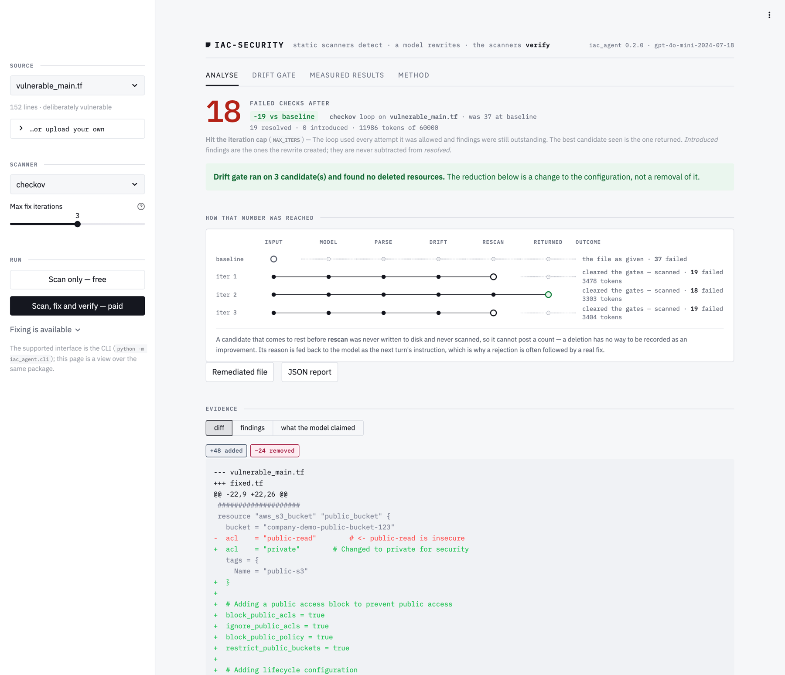
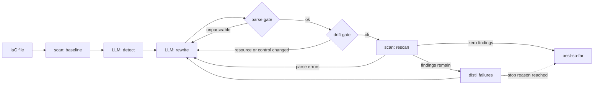

<div align="center">

# LLM IaC Security

**An LLM proposes fixes for Terraform and Dockerfile misconfigurations. A scanner and two
gates decide whether the fix is allowed to count.**

[](https://github.com/Shlok014/llm-iac-security/actions/workflows/ci.yml)
[](pyproject.toml)
[](LICENSE)
[](eval/results/RESULTS.md)

</div>

Started as a third-year B.Tech project at Symbiosis Skills & Professional University (Pune,
December 2025) by four authors. Everything after the initial import commit is post-submission
engineering by Shlok Dahale. [Origin and attribution](docs/README_FULL.md#origin--attribution).

<div align="center">
  
</div>

## The problem

A scanner finding can be made to disappear by deleting the resource it was about. That scores a
perfect finding count, passes a syntax check, and leaves the infrastructure worse: the next
`terraform apply` removes the control. Counting findings alone cannot tell a fix from a deletion.

## The approach

1. **Baseline.** Checkov (and optionally Trivy) scan the file. Scanners are reported separately,
   never merged.
2. **Propose.** An LLM reads the file and the failed checks and returns a rewritten file.
3. **Parse validation.** The candidate must parse as Terraform (python-hcl2) or pass the
   Dockerfile structure check. Unparseable output is never scanned and never accepted.
4. **Resource-drift protection.** The candidate is compared with the original. It is rejected if
   it deletes or renames a Terraform resource or module call, changes `count`/`for_each` or a
   module `source`, or changes in-file variable defaults or locals those controls reference. For
   Dockerfiles it compares base-image family, per-stage application copies and startup presence.
5. **Verified rescan.** Only a candidate that passed both gates is written to a temporary file
   and rescanned. A rescan that reports parse errors is rejected, because a count from a partly
   read file is a floor, not a result.
6. **Loop.** Scanner failures from the rescan go back to the model. The loop stops on one of four
   reasons (`converged`, `max_iters`, `no_progress`, `token_budget`) and returns the **best**
   candidate it saw, or the original file if none improved it. The input file is never modified.



Each box maps to code: `scan` is `iac_agent/scanners.py`; detect, rewrite and `distil failures`
are `detect_vulnerabilities`, `generate_fix` and `distill_failures` in `iac_agent/llm.py`; the
parse and drift gates are `check_validity` and `compute_drift` in `iac_agent/validity.py`; the
loop, the four stop reasons and best-so-far are in `iac_agent/loop.py`.

Scanner failures are errors, not clean results. A missing binary, a timeout, empty or non-JSON
output, or Checkov's "no runners to run" message all raise `ScannerError`. The CLI exits **0**
clean, **1** findings remain, **2** tooling failed or the input was not fully parsed, **3** the
model call failed.

## Quick start (no API key, no cost)

Needs Python 3.11 to 3.13 (not 3.14: Checkov's `networkx` dependency crashes there).

```bash
make setup                                          # venv + editable install
.venv/bin/iac-agent scan samples/vulnerable_main.tf # Checkov scan; no key, no model
echo "exit=$?"                                      # 1 = findings remain
make report                                         # regenerate eval/results/RESULTS.md offline
make ui                                             # optional Streamlit view
```

Trivy is a separate Go binary, not a pip package (`brew install trivy`). `--scanner trivy` and
`--scanner both` need it; the default Checkov scan does not.

Remediation is the paid path and has no `make` target on purpose:

```bash
cp .env.example .env                                  # add an OpenAI key
.venv/bin/iac-agent fix samples/s3_public.tf --out out/
```

`fix` writes only into `--out` and refuses an `--out` that would overwrite the input.
`--dry-run` writes nothing. `make test` runs the hermetic suite with `OPENAI_API_KEY` unset.

## Evaluation results

Everything below is quoted from [`eval/results/RESULTS.md`](eval/results/RESULTS.md), which is
generated by `make report` from the committed `eval/results/results.json` and the committed
response cache in `eval/cache/`. Setup: `gpt-4o-mini-2024-07-18`, `temperature=0`, 6 fixtures
x 2 corpus variants x 3 repeats = 72 model calls, 52 hand-labelled planted flaws. Figures are
`mean [min, max]` over 3 repeats, descriptive only.

| Scanner | Variant | Findings before | After | Resolved | Introduced |
|---|---|---:|---:|---:|---:|
| Checkov | commented | 70 | 42.3 [42, 43] | 39.5% | 0 |
| Checkov | stripped | 70 | 42.3 [41, 44] | 39.5% | 0 |
| Trivy | commented | 57 | 30.3 [18, 37] | 46.8% [35.1, 68.4] | 0 |
| Trivy | stripped | 57 | 37.7 [37, 38] | 33.9% | 0 |

- **Output validity:** 36 of 36 generated outputs parsed (RESULTS.md section 5).
- **Drift:** on `samples/vulnerable_main.tf` the model deleted
  `aws_s3_bucket_policy.public_policy` in 5 of 6 runs. That removes a finding by removing the
  resource. This is the failure the drift gate exists to catch (RESULTS.md section 6 lists each
  event). These runs predate the Dockerfile structural gate.
- **Detection is unresolved.** The LLM's recall is 39.1% on the comment-stripped corpus against
  Checkov's 46.2%, but the substring matcher that produces it may be penalising correct
  paraphrases. Re-scoring the same saved findings with token matching gives 57.1%, and that
  matcher was chosen after seeing the misses, so neither number is a verdict. Detail and the
  rescore command: [`docs/README_FULL.md`](docs/README_FULL.md#measured-results).
- **Label leakage:** fixtures annotate their own flaws in comments; recall drops 13.5 points
  when those comments are stripped (RESULTS.md section 4).

Reproduce: `make report` (offline, free). A fresh live sweep costs money and needs a key:
`.venv/bin/python -m eval.run_eval run --fresh`. Method and threats to validity:
[`docs/EVALUATION.md`](docs/EVALUATION.md).

## Limitations

- **Small and synthetic.** The published numbers come from 6 hand-written vulnerable fixtures,
  3 repeats, one model. The corpus has since grown to 12 fixtures and 91 labelled flaws, but the
  evaluation has not been re-run on it.
- **Syntax, not semantics.** The parse gate shows output parses; it does not run
  `terraform validate`, resolve references, or build the Dockerfile. A file can pass and still
  not apply.
- **Drift is structural.** It compares declared resources and a set of instance controls, not a
  `terraform plan`. A resource reconfigured into uselessness while keeping its address and
  controls can pass.
- **The drift gate can be off.** If the original file's resources cannot be extracted, the loop
  skips the drift gate for every candidate and records a note ("drift gate disabled") in the
  result. The exit code does not change.
- **A zero-finding rescan is only as good as the scanners' rules.** Flaws neither scanner has a
  rule for stay invisible: 24 of the 52 evaluated labels are not detected by either.
- **AWS Terraform and Dockerfiles only.** No Azure, GCP, Kubernetes or CloudFormation.
- **Your IaC is sent to the model provider on `fix`.** `scan` never calls a model. See
  [`docs/THREAT_MODEL.md`](docs/THREAT_MODEL.md).
- `samples/` is deliberately vulnerable and includes fake placeholder credentials; do not
  deploy it ([`SECURITY.md`](SECURITY.md)).

## License

MIT; see [`LICENSE`](LICENSE).

## More detail

[`docs/README_FULL.md`](docs/README_FULL.md) is the previous long README, unchanged apart from
link paths: full evaluation tables, the matcher caveat, label leakage, the fail-closed history.
Also: [architecture](docs/ARCHITECTURE.md), [low-level design](docs/LLD.md),
[evaluation method](docs/EVALUATION.md), [threat model](docs/THREAT_MODEL.md),
[decision records](docs/DECISIONS.md), [development guide](docs/DEVELOPMENT.md),
[UI design](docs/UI_DESIGN.md), [errata for the submitted report](ERRATA.md).
